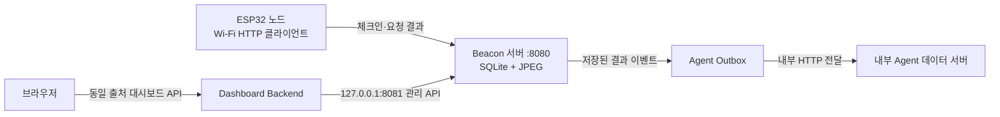

# 농장 비콘 Agent Dashboard 개발 명세서 (DASHBOARD v1)

작성일: 2026-11-15  
기준 구현: `/home/nano/beacon`의 `beacon_server.py`, `store.py`, `policy.py`, `beaconctl.py`, `firmware/beacon_node`  
대상 작업자: 후속 Codex 에이전트

이 문서는 기존 비콘 통신 기능을 대시보드와 내부 Agent 데이터 흐름에 연결하기 위한 요구사항이다. **현재 구현된 기능과 대시보드 구현에서 추가해야 하는 기능을 구분한다.** 현재 서버 계약과 다른 동작이 발견되면 임의로 노드 프로토콜을 바꾸지 말고 이 문서와 호환되게 서버/API를 확장한다.

## 1. 목표와 시작 전제

Jetson에서 여러 Timer Camera 노드를 목록으로 확인하고, 각 노드의 등록 상태·통신 상태·체크인 주기·위치·센서 구성을 관리한다. 관리자는 이미지나 센서 측정을 요청하고 결과를 확인한다. 결과는 먼저 Jetson의 내부 저장소에 보존한 뒤, 설정된 내부 Agent 수집기에 중복 없이 전달할 수 있어야 한다.

대시보드 개발 시작 시 ESP32가 USB로 펌웨어 컴파일·업로드를 마쳤고 Wi-Fi로 Beacon 서버에 체크인한다고 가정한다. 현재 실기에서 `tc-004f8c`의 이미지 명령 5, 6이 각각 `done`으로 끝났고, 서버에 640×480 JPEG가 저장된 것을 확인했다. 펌웨어는 노드가 요청할 때만 이미지를 촬영·전송한다.

범위 밖: OTA, 노드에서 서버로의 실시간 푸시, 대시보드 UI의 LLM 추론, 외부 인터넷 공개, TLS 구성, 노드의 상시 Wi-Fi 연결.

## 2. 구성과 발견 방식



노드는 서버에 먼저 접속하는 풀 방식이다. Beacon 서버는 노드용 HTTP `0.0.0.0:8080`과 관리 API `127.0.0.1:8081`을 제공한다. 관리 API는 인증이 없으므로 브라우저에서 직접 호출하거나 LAN에 노출하지 않는다. 대시보드는 Jetson의 백엔드를 통해 관리 API를 호출한다. 기본 배포는 대시보드도 loopback에 바인딩하고, 원격 사용은 SSH 터널 등으로 제공한다.

### 장치 발견의 의미

- 현재 서버는 LAN 검색, mDNS 검색, ARP 스캔, USB 포트 검색을 하지 않는다.
- 노드는 유효한 첫 체크인에서 `tc-<eFuse MAC 하위 3바이트 hex>` ID로 DB에 생성된다. 따라서 UI의 “장치 검색/새로고침”은 서버의 노드 목록을 다시 읽는 동작이다. 노드가 한 번도 체크인하지 않았다면 목록에 없으며, 사용자가 펌웨어·전원·Wi-Fi·서버 주소를 확인해야 한다.
- 발견된 미등록 노드는 `DISCOVERED`로 표시한다. 이는 같은 LAN의 모든 ESP32를 뜻하지 않는다.
- `online`은 마지막 체크인과 서버가 준 `next_given`으로 판정되는 상태다. 마지막 IP가 남아 있어도 현재 접속 중이라고 단정하지 않는다.

## 3. 현재 구현에서 사용할 수 있는 노드 기능

### 노드 상태와 정책

| 상태 | 의미 | 현재 동작 |
|---|---|---|
| `DISCOVERED` | 첫 체크인으로 서버에 알려짐, 아직 관리자가 등록하지 않음 | 기본 체크인 약 900초 간격, 명령 배분 안 함 |
| `ATTACHED` | 관리자가 등록함 | 기본 `interval_s=300`; 명령 큐 처리 |
| `DETACHED` | 관리자가 해제함 | 체크인 약 3600초 간격, 명령 배분 안 함, 대기 명령 만료 |
| `HIBERNATING` | 관리자 종료 명령을 노드가 수행함 | RTC 타이머 없이 전원 차단; USB/전원 재투입이 필요할 수 있음 |

정상 모드에서 interval은 60~14,400초다. 서버는 `next`에 ±10% 지터를 적용하며 [30, 15,300]초로 제한한다. 우선순위는 세션 요청, watch 기간(60초), 낮은 배터리, 기본 interval 순이다. 서버 설정 `vbat_critical_mv=3300`, `vbat_low_mv=3450` 미만이면 주기를 늘리고 이미지 명령을 실패 처리할 수 있다. 현재 `VBAT_SCALE`은 보정 전 가정값이므로 UI는 전압을 그대로 표시하되 배터리 잔량 퍼센트나 수명 보증을 표시하지 않는다. 보정 여부를 메타데이터/설정에 기록한다.

명령은 체크인 응답에 최대 4개 실린다. 결과가 오지 않으면 120초 후 재배분할 수 있고 최대 3회 배분한다. 대시보드는 `queued`, `dispatched`, `done`, `failed`, `expired`를 그대로 표시하고, 큐 등록을 “즉시 촬영”으로 표현하지 않는다. 일반 명령의 실제 시작은 다음 체크인 시점이다.

### 명령 종류

| 기능 | 현재 명령 | 인자 및 주의 |
|---|---|---|
| 사진 촬영 | `image` | `fs`: QVGA/VGA/SVGA/XGA/HD/SXGA/UXGA, 기본 VGA; `q`: 4~40, 기본 12; `warm`: 0~3000ms, 기본 500. 현재 실기 확인은 VGA, q=12, warm=500 |
| 센서 측정 | `sensor` | Grove 버스 SHT30(주소 0x44/0x45), DHT20(0x38)을 탐색. 현재 펌웨어는 센서 미연결 시 `sensor_absent` 결과를 저장 |
| 빠른 Wi-Fi 설정 | `config` | 현재 `fast` 0/1만 지원. SSID/비밀번호/서버 IP 변경 기능이 아님 |
| 종료 | `hibernate` | 결과를 올린 뒤 RTC 타이머 없이 종료. 회수 전용으로 확인 후 실행 |

Wi-Fi SSID/비밀번호와 서버 호스트는 펌웨어 설정(`secrets.h`, `config.h`)이며 원격 대시보드에서 변경할 수 없다. 변경에는 USB 연결, 재컴파일, 수동 업로드가 필요하다. 대시보드에는 비밀번호 입력란이나 비밀값 표시를 만들지 않는다. 네트워크 진단은 마지막 IP, RSSI, 채널, `wifi_ms`, fast 경로 결과를 표시한다.

### 저장되는 현재 원시 데이터

- 체크인: `fw`, `boot`, `seq`, `vbat_mv`, `rssi`, `ch`, `t.wifi_ms`, `t.fast`, `t.prev_awake_ms`, `t.prev_result`, 서버가 준 `next_given`, 수신 시각, 소스 IP.
- 이미지 결과: JPEG 파일, byte 수, 폭/높이, `warm_ms`, 명령 ID, 수신 시각. 저장 위치는 `/mnt/nvme/beacon/images/<node_id>/<UTC timestamp>_<cmd_id>.jpg`다. 서버가 JPEG SOI/EOI와 SOF 크기를 확인한다.
- 센서 결과: `readings.body`에 원본 JSON을 보존한다. 현재 예는 `{"ok":1,"sensors":[{"type":"sht30","addr":68,"t_c":21.43,"rh":63.2}]}`. 미연결은 `{"ok":0,"err":"sensor_absent"}`이다.
- 현재 테이블은 `nodes`, `commands`, `readings`, `images`, `checkins`다. 노드 metadata, 히스토리 조회 API, 이미지 바이트 다운로드 API, Agent outbox는 아직 없다. 아래 항목은 이 대시보드를 위해 추가한다.

## 4. 현재 운영 방법과 CLI

서버는 Jetson에서 다음처럼 실행한다. 대시보드와 관리 CLI는 이 서버의 관리 API를 사용한다.

```bash
cd /home/nano/beacon
python3 server/beacon_server.py --config server/config.json
```

현재 관리 CLI는 `/home/nano/beacon/tools/beaconctl.py`다. 아래 명령은 서버가 실행 중인 Jetson 셸에서 실행한다.

| 용도 | 명령 예 |
|---|---|
| 체크인한 전체 노드 | `python3 tools/beaconctl.py nodes` |
| 노드 등록, label 및 주기 지정 | `python3 tools/beaconctl.py attach tc-004f8c --label "북쪽 하우스" --interval 300` |
| 등록 해제 | `python3 tools/beaconctl.py detach tc-004f8c` |
| 주기 변경(초) | `python3 tools/beaconctl.py interval tc-004f8c 600` |
| 1~30분 watch 설정 | `python3 tools/beaconctl.py watch tc-004f8c --minutes 10` |
| 세션 요청(최대 180초) | `python3 tools/beaconctl.py session tc-004f8c --hold 60` |
| 센서 읽기 요청 | `python3 tools/beaconctl.py sensor tc-004f8c` |
| 센서 결과까지 대기 | `python3 tools/beaconctl.py sensor tc-004f8c --wait` |
| 사진 요청 | `python3 tools/beaconctl.py image tc-004f8c --fs VGA --q 12 --warm 500` |
| 사진 결과까지 대기 | `python3 tools/beaconctl.py image tc-004f8c --fs VGA --q 12 --warm 500 --wait` |
| 명령 결과 조회 | `python3 tools/beaconctl.py cmd 5` |
| 에너지 추정치 | `python3 tools/beaconctl.py energy tc-004f8c` |
| 물리적 회수용 hibernate | `python3 tools/beaconctl.py hibernate tc-004f8c` |

대시보드 버튼 동작은 위 CLI와 같은 관리 API 의미를 사용한다. 별도의 노드 프로토콜이나 직접 DB 쓰기를 만들지 않는다.

## 5. 기존 Beacon 관리 API 계약

기본 관리 URL은 `http://127.0.0.1:8081`이며 JSON을 주고받는다. 관리 API에는 현재 인증이 없다. 반드시 loopback 경계를 유지한다.

| 메서드·경로 | 요청/응답 | 의미 |
|---|---|---|
| `GET /admin/nodes` | JSON 배열 | 노드 상태, online, last_seen, interval, IP/RSSI/전압/seq/fw 등. `token`은 반환하지 않음 |
| `POST /admin/nodes/{id}/attach` | `{ "label"?: string, "interval_s"?: int }` | ATTACHED로 등록, 토큰을 만들고 다음 체크인에서 전달. 200 |
| `POST /admin/nodes/{id}/detach` | `{}` | DETACHED, 세션 종료 및 queued/dispatched 명령 만료. 200 |
| `POST /admin/nodes/{id}/interval` | `{ "interval_s": 60..14400 }` | ATTACHED 노드의 다음 기본 주기 변경. 200 |
| `POST /admin/nodes/{id}/watch` | `{ "minutes": 1..30 }` | 기간 중 다음 주기를 60초로 조정. 200 |
| `POST /admin/nodes/{id}/session` | `{ "hold_s": 0..180 }` | 다음 체크인부터 롱폴 세션 요청. 200 |
| `POST /admin/nodes/{id}/commands` | `{"type":"image","params":{"fs":"VGA","q":12,"warm":500}}` | ATTACHED 노드 명령 생성. 202와 `cmd_id` 반환. `sensor`, `image`, `config`, `hibernate` 지원 |
| `POST /admin/nodes/{id}/hibernate` | `{}` | hibernate 명령을 큐에 넣고 `cmd_id` 반환. 202 |
| `GET /admin/commands/{cmd_id}` | JSON 객체 | 상태, attempts, timestamps, result 확인 |
| `GET /admin/commands/{cmd_id}/wait?timeout=600` | JSON 객체 | 완료까지 대기, 최대 600초 |
| `GET /admin/nodes/{id}/energy` | JSON 객체 | 설정된 전류 가정과 체크인으로 계산한 추정치. 실측값이 아님 |

HTTP 오류는 `{ "error": "..." }` JSON이다. 대표 상태 코드는 400 잘못된 입력, 404 알 수 없는 노드/명령, 409 ATTACHED 아님, 401 노드 인증 실패, 413 요청 크기 초과다.

## 6. 대시보드 화면 및 사용자 흐름

### 6.1 Fleet 화면

첫 화면은 등록 상태와 무관하게 서버가 아는 모든 노드를 보여준다. 검색/필터: label, node ID, 상태, online/offline, 위치, 센서 종류. 새로고침은 `GET /admin/nodes`를 다시 호출한다.

표시 열: label, node ID, 상태, online, 마지막 체크인, 다음 체크인 예상 구간, last IP, RSSI, 채널, 최근 배터리 보고값, 펌웨어 버전, 위치, 센서 요약, 미완료 명령 수. `next_given`은 지터를 포함한 서버의 마지막 전달값이다. UI가 추정하는 시간은 예상치로 표시하고 명령 도착을 보장하지 않는다.

`DISCOVERED` 노드에 “등록” 액션, `ATTACHED` 노드에 “주기 변경”, “watch”, “세션”, “센서 읽기”, “사진 촬영”, “해제”, “hibernate” 액션을 제공한다. 위험한 hibernate에는 확인 단계를 둔다. `DETACHED` 노드는 등록을 다시 할 수 있고, `HIBERNATING`은 전원이 다시 켜져 새 체크인하기 전까지 온라인으로 만들 수 없음을 알린다.

“주변 장치 검색” 버튼이 있으면 실제 무선/USB 스캔으로 오해하지 않도록 “서버에서 체크인된 장치 새로고침”으로 표기한다. 아직 체크인하지 않은 ESP32를 찾았다고 가장하지 않는다.

### 6.2 노드 상세 화면

탭 또는 구획을 제공한다.

1. **상태**: 상태/온라인, 마지막 체크인, 예상 다음 체크인, IP, RSSI, 채널, fw, seq, boot, `wifi_ms`, fast 성공, `prev_awake_ms`, `prev_result`, 전압 원시값과 보정 경고.
2. **위치·장치 metadata**: label, 설치 위치, 현장/구역/열/행, 위도·경도(선택), 설치일, 메모, 태그, 하드웨어 모델, 펌웨어/보드 메모, 센서 목록. 수정 시 저장 성공/실패를 보여준다.
3. **센서**: 시간순 측정 목록과 현재 값 카드. 알려진 타입은 단위와 함께 정규화하고 원시 JSON 보기 제공. 알 수 없는 센서 타입/필드는 숨기거나 버리지 말고 JSON fallback으로 표시한다.
4. **이미지**: 최근 사진 썸네일/큰 보기, 촬영 시각, 해상도, bytes, `warm_ms`, 명령 ID. JPEG를 대시보드 API를 통해 제공한다. 로컬 파일시스템 경로나 임의 경로를 브라우저에 받지 않는다.
5. **명령 기록**: type, params, 상태, attempts, created/dispatched/done, reason, 결과. 진행 중 명령을 주기적으로 갱신하며, 큐에 있는 동안 “노드 다음 체크인 대기”를 설명한다.
6. **Agent 전달**: 내부 Agent 저장 여부, pending/delivered/retry 상태, 마지막 오류, 재전달 액션.

### 6.3 주요 흐름

**새 노드 등록:** 사용자가 USB로 준비한 노드를 Wi-Fi에 연결하고 첫 체크인을 기다린다 → `DISCOVERED` 행을 선택한다 → label/interval 및 metadata를 저장하고 attach한다 → 다음 체크인에서 토큰 전달 → 상태가 ATTACHED로 갱신된다.

**사진/센서 요청:** 사용자가 명령을 제출한다 → 명령 ID와 queued 상태를 즉시 보여준다 → 서버가 다음 체크인 또는 세션 폴에서 전달한다 → 완료/실패를 polling 또는 wait API로 갱신한다 → 결과 DB 저장 후 상세 화면과 Agent 전달 상태를 갱신한다.

**낮은 지연으로 상호작용:** watch는 최대 30분 동안 60초 주기를 쓰고, session은 최대 180초 롱폴을 요청한다. 이 기능도 첫 체크인은 다음 예정 주기를 기다린다. 배터리 절약과 지연의 교환을 UI에 보여준다.

## 7. metadata, 결과 이력, 이미지 제공 확장

다음은 현재 구현에 없는 기능이며 대시보드 작업에서 추가한다. DB 변경은 기존 DB를 보존하는 additive migration으로 한다. 초기화나 기존 파일 삭제를 하지 않는다.

### 7.1 노드 metadata 스키마

`nodes.metadata_json` 또는 별도 `node_metadata` 테이블로 저장한다. 아래와 같은 v1 JSON을 기준으로 하고, unknown/custom 값을 보존한다.

```json
{
  "schema_version": 1,
  "label": "북쪽 하우스 2열",
  "location": {
    "site": "농장 A",
    "zone": "북쪽 하우스",
    "row": "2",
    "position": "동쪽 끝",
    "latitude": null,
    "longitude": null
  },
  "installed_at": "2026-11-15",
  "hardware": {"model": "M5Stack Timer Camera U082", "notes": ""},
  "sensors": [
    {"sensor_id": "air-1", "type": "sht30", "model": "SHT30", "address": 68,
     "bus": "Grove-I2C", "location": "잎 높이", "enabled": true,
     "units": {"t_c": "°C", "rh": "%RH"}, "notes": ""}
  ],
  "tags": ["온실", "관수구역-A"],
  "custom": {}
}
```

모든 필드는 선택 가능하되 `schema_version`, node ID, update timestamp는 서버가 관리한다. IP, SSID 비밀번호, token은 metadata에 넣지 않는다. sensor `address`는 숫자로 저장하고 화면에는 `0x44`와 decimal을 함께 표시할 수 있다. metadata의 센서 목록은 설치 목록이며 실제 읽기 성공 여부와 별도로 표시한다.

### 7.2 필요한 관리 API 확장

기존 API를 호환되게 유지하면서 아래를 추가한다.

| 메서드·경로 | 동작 |
|---|---|
| `GET /admin/nodes/{id}` | 노드 상세 및 metadata |
| `GET /admin/nodes/{id}/metadata` | metadata 객체와 `updated_at` |
| `PUT /admin/nodes/{id}/metadata` | metadata 전체 교체 또는 명세된 merge 규칙으로 저장. 유효성 검사 후 응답에 저장된 객체 반환 |
| `GET /admin/nodes/{id}/history?limit=&before=&kind=` | checkin, command, reading, image를 시간순으로 반환. 최대 limit를 정하고 pagination 제공 |
| `GET /admin/commands/{cmd_id}/image` | 저장된 명령 JPEG를 `image/jpeg`로 스트리밍. 명령이 image 결과가 아니면 404 |

`GET /admin/nodes`에 metadata의 label/location 요약을 추가해도 된다. Metadata 수정은 attach 상태와 독립적으로 허용한다. ID 패턴 검증, JSON 크기 상한, 400/404 오류 형식을 현재 API와 맞춘다. 이미지 경로는 DB의 cmd ID로 찾아 허용된 `images_dir` 아래인지 확인하며 요청 경로 문자열을 파일 경로로 직접 사용하지 않는다.

### 7.3 Agent 내부 서버 전달

현재 Beacon 서버에는 Agent 수집 API나 outbox가 없다. 내부 Agent 서버의 실제 주소는 배포 설정으로 주입하고 코드에 IP/비밀번호를 하드코딩하지 않는다. 전달 URL이 설정되지 않으면 결과는 Beacon DB에 보존하고 UI에 `not_configured`를 표시한다.

새로운 durable outbox를 추가한다. 결과를 Beacon의 `readings` 또는 `images`에 성공적으로 저장한 뒤 outbox 이벤트를 만든다. `event_id`는 `beacon-result:<cmd_id>`로 고정해 중복 전달을 받는 서버도 멱등 처리한다. 이벤트 재전송은 제한 없는 at-least-once이며 실패 시 지수 backoff와 마지막 오류를 저장한다. UI에는 pending/delivered/retry/error 상태와 재시도 버튼을 제공한다. 서버 재시작 후 pending 이벤트도 이어서 보낸다.

제안하는 내부 수집 계약은 `POST {agent_ingest_url}/api/v1/beacon/events`다. 이 route가 이미 다른 이름으로 존재하면 adapter에서 매핑하되 이벤트 필드는 보존한다.

센서/config 결과는 JSON으로 전달한다. 이미지 결과는 `multipart/form-data`로 `event` JSON 파트와 `image` JPEG 파트를 전달해 base64 확장을 피한다. 헤더 `Idempotency-Key: beacon-result:<cmd_id>`를 넣는다. 2xx 응답은 전달 완료, 그 외는 retry 대상이다.

```json
{
  "schema": "beacon.result.v1",
  "event_id": "beacon-result:5",
  "kind": "image",
  "node_id": "tc-004f8c",
  "command_id": 5,
  "received_at": "2026-11-15T07:32:11Z",
  "metadata": {"schema_version": 1, "label": "북쪽 하우스 2열"},
  "result": {"mime_type": "image/jpeg", "bytes": 13632,
              "width": 640, "height": 480, "warm_ms": 512}
}
```

센서 이벤트의 `result`에는 원본 JSON 전체를 넣는다. UI/Agent adapter는 SHT30 `t_c`, `rh`를 온도 °C와 상대습도 %로 매핑할 수 있지만 `raw` 필드도 보존한다. 향후 sensor type이나 JSON 필드가 늘어도 유효한 JSON 전체를 저장하고 전송해야 하며, unknown type 때문에 결과 전체를 거부하지 않는다. 이미지도 원본 JPEG와 측정 metadata를 함께 보낸다. Agent 데이터 저장 성공을 이미지/센서의 Beacon 저장 성공과 별개로 표시한다.

## 8. 대시보드 백엔드 구성 요구

- Python 표준 라이브러리 기반 Beacon 서버를 계속 사용할 수 있다. UI는 별도 frontend로 만들 수 있으나 브라우저가 `127.0.0.1:8081`을 직접 호출하지 않도록 동일 출처 BFF/API를 둔다.
- BFF는 기존 loopback admin API를 호출한다. metadata/history/image/outbox 확장도 같은 경계 안에서 제공한다.
- Admin API 또는 BFF는 현재 토큰을 반환하지 않는다. 화면·응답·로그에 Wi-Fi 자격정보, node token, secrets 파일 내용을 기록하지 않는다.
- 제어 API의 origin/CSRF를 same-origin으로 제한한다. 관리 서버를 `0.0.0.0:8081`로 바꾸지 않는다.
- 설정은 config file/environment로 주입한다. 데이터는 `/mnt/nvme/beacon` 아래에 둔다. Agent 서버 연결 실패가 Beacon 결과 저장을 실패시키지 않는다.
- UI에서 종료/해제/hibernate와 이미지 요청은 즉시 실행 상태를 표시하고, 중복 제출 방지를 위해 pending command를 보여준다. 서버 요청은 idempotency 또는 사용자 확인으로 실수 중복을 줄인다.

## 9. Agent가 읽을 수 있는 내부 조회 모델

대시보드 백엔드는 Agent가 사용할 안정적인 read-only 조회 API 또는 repository service를 제공한다. Agent는 DB 파일을 직접 열지 않는다.

최소 조회 집합:

- `nodes`: ID, 현재 상태/online, 위치 metadata, 설치 센서 metadata, 마지막 checkin.
- `readings`: node ID, command ID, 수신 시각, raw payload, 추출된 typed measurements.
- `images`: node ID, command ID, 수신 시각, 해상도/bytes/warm, 안전한 내부 image endpoint.
- `commands`: 상태와 실패 reason. 명령 실행/재시도는 관리 API 권한이 있는 사용자 작업으로 남긴다.

값을 합칠 때 데이터 출처 시각을 유지한다. 최신 센서값은 `received_at`이 가장 최근인 성공 reading에서 가져오며, 과거 값이나 노드 metadata 변경을 새 측정값처럼 표시하지 않는다. 이미지 endpoint는 브라우저/Agent 권한 경계에 맞춰 제공하고 OS 절대 경로를 노출하지 않는다.

## 10. 완료 기준

1. 첫 체크인을 마친 `DISCOVERED`와 기존 노드가 Fleet 화면에 나타난다. 체크인하지 않은 무선 기기를 검색한 것처럼 표시하지 않는다.
2. online/offline, 네 상태, last_seen/IP/RSSI/channel/fw/seq/next, 원시 배터리값을 보여준다.
3. attach/detach, label/metadata 편집, interval, watch, session이 기존 API와 같은 제한·의미로 동작한다.
4. 이미지와 sensor 요청은 command ID를 보여주고 queued→dispatched→terminal 상태를 추적한다. 요청 전에 다음 checkin까지 지연될 수 있음을 표시한다.
5. 현재 이미지 결과를 640×480 preview로 열고 bytes/warm_ms/time을 함께 표시한다. 이미지 응답은 JPEG이며 서버 파일시스템 임의 경로를 받지 않는다.
6. 현재 센서 JSON을 SHT30/DHT20 형식으로 렌더링하고 `sensor_absent` 및 unknown sensor payload를 처리한다.
7. metadata가 서버 재시작 후에도 보존되고 location/sensor inventory 검색·필터에 사용된다.
8. 결과는 Beacon 저장 후 Agent outbox에 들어가며, 성공/재시도/실패가 보인다. 같은 `cmd_id`의 중복 수신/전달은 Agent 저장에서 한 건으로 처리된다.
9. 관리 토큰·Wi-Fi 비밀번호는 API/HTML/로그에 노출되지 않고 admin port 8081은 loopback에 유지된다.
10. API와 DB migration 및 UI 동작에 대한 테스트를 추가하고, 실제 브라우저 흐름과 저장·재시작·중복 전달을 검증한다. 하드웨어 미연결 환경에서 통과한 항목과 실기 확인 항목을 분리 기록한다.

## 11. downstream 구현자가 먼저 확인할 파일

- 현재 API/정책: `server/beacon_server.py`, `server/policy.py`
- DB/결과 저장: `server/store.py`
- 현재 CLI와 payload 예시: `tools/beaconctl.py`
- 펌웨어 프로토콜/센서 JSON: `firmware/beacon_node/netproto.cpp`, `sensors.cpp`, `camera_cap.cpp`
- 운영 전제와 통신 규약: `SPEC_NET.md`
- 이번 작업의 추가 요구사항: 이 문서

하드웨어 동작을 이미 확인한 값은 서버 접속 및 이미지 결과 저장이다. 센서는 아직 미연결이며, 배터리 전압 보정·저전력 실측·배터리 단독 RTC 사이클은 미완료로 표시한다.
